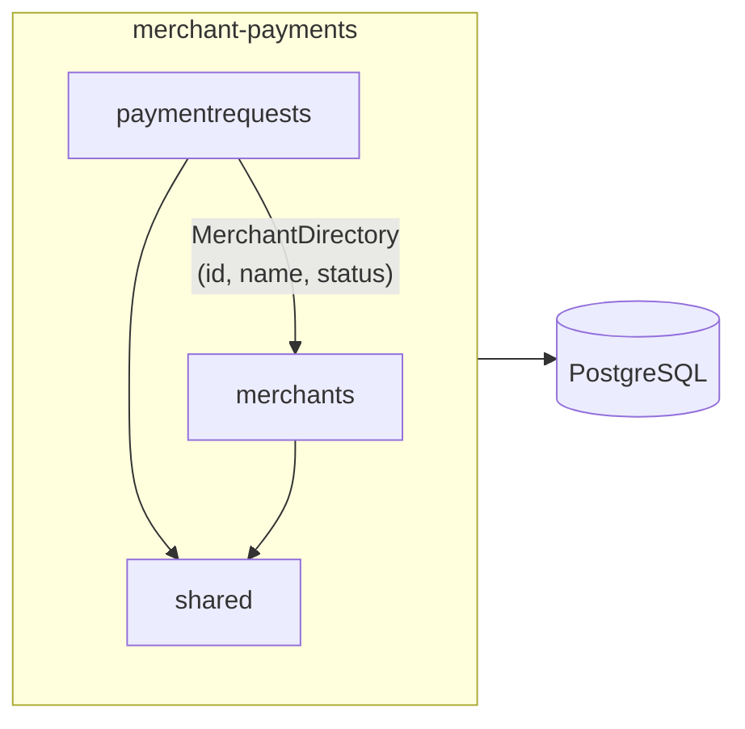

# merchant-payments

A payment-request service shaped like iDEAL: merchants are onboarded, create
payment requests, and payers pay them. It is a portfolio project in which I
designed the schema, the API and the module boundaries from scratch, and
recorded every significant decision.

**Java 25 · Spring Boot 4.1 · Spring Modulith · PostgreSQL 17 · Flyway · Testcontainers · Docker · GitHub Actions**

[](https://github.com/kronos2713/merchant-payments/actions/workflows/ci.yml)

Status: **MVP (Phase 1)**. The core flows work end to end; there is no
authentication yet. See [Known limitations](#known-limitations).

## Run it

You need Docker. Nothing else: the image builds the application itself.

```bash
docker compose --profile app up --build
```

This starts PostgreSQL, waits until it is healthy, then starts the application
on port 8080. Flyway creates the schema on startup.

- **Swagger UI:** http://localhost:8080/swagger-ui.html
- **Postman:** import `docs/postman/merchant-payments.postman_collection.json`
  and run the whole collection with the Collection Runner. It creates its own
  test data, so it can run repeatedly against the same database.
- **Health:** http://localhost:8080/actuator/health

**From an IDE:** run `MerchantPaymentsApplication`. Spring Boot's Docker
Compose support starts only PostgreSQL (the app service sits behind the `app`
profile), so the IDE and the container never compete for port 8080. PostgreSQL
is published on port 5433 for database tools.

## Tests

```bash
./mvnw verify
```

Docker must be running: the integration tests start a real PostgreSQL 17 with
Testcontainers. CI runs the same command on every push.

| Kind | What it proves | Examples |
| --- | --- | --- |
| Domain unit tests | Entity rules and boundaries, with a fixed clock | `MerchantTest`, `PaymentRequestTest`, `MoneyTest`, `IbanValidatorTest` |
| Persistence tests | Mappings, migrations and constraints against real PostgreSQL | `MerchantPersistenceIntegrationTest`, `PaymentRequestPersistenceIntegrationTest` |
| Service integration tests | Transactions, optimistic locking, duplicate detection, list filters | `MerchantServiceIntegrationTest`, `PaymentRequestServiceIntegrationTest` |
| Web layer tests | Status codes, validation and Problem Details responses | `MerchantControllerTest`, `PaymentRequestControllerTest`, `MerchantApiErrorsIntegrationTest` |
| Architecture test | No module reaches into another module's internals | `ModularityTests` |

## API overview

Errors are [RFC 9457 Problem Details](https://www.rfc-editor.org/rfc/rfc9457)
(`application/problem+json`) everywhere. Amounts are in minor units: `1250`
means 12.50 EUR.

**Merchant onboarding** (an operator role once authentication exists)

| Method | Path | What it does |
| --- | --- | --- |
| `POST` | `/merchants` | Register a merchant (starts PENDING) |
| `GET` | `/merchants` | List merchants, newest first |
| `GET` | `/merchants/{merchantId}` | Get a merchant; the IBAN is masked |
| `POST` | `/merchants/{merchantId}/activation` | PENDING → ACTIVE |
| `POST` | `/merchants/{merchantId}/suspension` | ACTIVE → SUSPENDED |
| `POST` | `/merchants/{merchantId}/reactivation` | SUSPENDED → ACTIVE |

**Merchant**

| Method | Path | What it does |
| --- | --- | --- |
| `POST` | `/merchants/{merchantId}/payment-requests` | Create a payment request |
| `GET` | `/merchants/{merchantId}/payment-requests` | List, filter by `status` or `merchantReference` |
| `GET` | `/merchants/{merchantId}/payment-requests/{id}` | Get one of the merchant's requests |
| `POST` | `/merchants/{merchantId}/payment-requests/{id}/cancellation` | Cancel an open request |

**Payer**

| Method | Path | What it does |
| --- | --- | --- |
| `POST` | `/payment-requests/{id}/payment` | Pay a payment request |

## Architecture

One deployable Spring Boot application, split into Spring Modulith modules.
The boundaries are checked on every build.



- **`merchants`:** onboarding and the merchant lifecycle.
- **`paymentrequests`:** creating, listing, cancelling and paying requests.
  It knows merchants only through the public `MerchantDirectory` interface,
  never the `Merchant` entity.
- **`shared`:** `Money`, the clock, base exceptions, Problem Details, paging.

Each module keeps its entities, repositories and services in an `internal`
package. The schema is owned by Flyway; Hibernate only validates it.

## Key decisions

Each decision has an Architecture Decision Record in [`docs/adr`](docs/adr).

| ADR | Decision |
| --- | --- |
| [0001](docs/adr/0001-modular-monolith-with-spring-modulith.md) | A modular monolith with enforced module boundaries, not microservices |
| [0002](docs/adr/0002-application-generated-uuid-ids.md) | UUID v4 ids generated in the application: not guessable, known before insert |
| [0003](docs/adr/0003-database-guardrails-owned-by-flyway.md) | Flyway owns the schema; the database enforces its own rules with named constraints |
| [0004](docs/adr/0004-settlement-iban-is-write-only.md) | The settlement IBAN is write-only and masked everywhere |
| [0005](docs/adr/0005-status-transitions-as-action-endpoints.md) | Status changes through action endpoints; repeats are safe no-ops |
| [0006](docs/adr/0006-problem-details-and-database-uniqueness.md) | Problem Details errors; the database decides uniqueness, no check-then-insert |
| [0007](docs/adr/0007-injected-clock-at-microsecond-precision.md) | All time from one injected clock at PostgreSQL's microsecond precision |
| [0008](docs/adr/0008-money-as-minor-units-in-shared.md) | Money as minor units in a shared value object, EUR only |
| [0009](docs/adr/0009-expiry-computed-on-read.md) | Expiry computed when the status is read; there is no `getStatus()` |
| [0010](docs/adr/0010-payment-request-lifecycle-rules.md) | One defined outcome for every state and action in the lifecycle |
| [0011](docs/adr/0011-routes-split-by-caller.md) | Routes split by caller; another merchant's request is a 404 |
| [0012](docs/adr/0012-list-endpoint-semantics.md) | The list filters by logical status, translated to SQL |
| [0013](docs/adr/0013-multi-stage-dockerfile.md) | A multi-stage Dockerfile with a layered jar, running as non-root |

## Known limitations

These are deliberate MVP shortcuts, each with a planned safer version.

| Limitation | Planned fix |
| --- | --- |
| No authentication; the `merchantId` in the path is trusted | OAuth2 with Keycloak; the merchant comes from the token (Phase 3) |
| Paying an already paid request returns 409, also for a retry | Idempotency keys for payments (Phase 2) |
| A duplicate `merchantReference` returns 409 | Idempotent create: the same payload returns the existing request |
| A suspension can commit just after a payment checked the merchant | Locking or an equivalent guard (Phase 2) |
| Expired requests keep the stored status CREATED | A scheduled sweep that stores EXPIRED |
| No history of merchant status changes | An audit log with actor and reason |
| The settlement IBAN is stored in plain text | Encryption at rest |
| The payer can't view a request before paying it | `GET /payment-requests/{id}` with a minimal response |
| Offset paging without a covering index | A `(merchant_id, created_at, id)` index; cursor paging if needed |
| UUID v4 ids spread inserts across the index | UUID v7 for `payment_requests` |
| The image is about 600 MB | A distroless or `jlink` runtime |

## Roadmap

Planned, not built yet:

1. **Phase 2:** idempotency keys and concurrency protection.
2. **Phase 3:** authentication and roles with Keycloak, the expiry sweep.
3. **Phase 4:** end-of-day settlement with Spring Batch.
4. **Phase 5:** domain events with the outbox pattern and Kafka.
5. **Phase 6:** resilience (retries, circuit breakers, rate limiting) and
   performance.
6. **Phase 7:** observability (metrics, tracing) and deployment.

## Tech stack

| Technology | Why it is here |
| --- | --- |
| Java 25 | The current LTS release |
| Spring Boot 4.1 | The standard for Java backends; Problem Details and Docker Compose support built in |
| Spring Modulith 2.1 | Module boundaries that are verified, not just agreed |
| Spring Data JPA / Hibernate | Entities with optimistic locking; Specifications for optional filters |
| PostgreSQL 17 | Check constraints, `timestamptz`, a realistic production database |
| Flyway | Versioned plain SQL migrations, reviewed like code |
| Bean Validation | Request validation with field-level errors, including a custom `@ValidIban` |
| springdoc-openapi 3 | Swagger UI and an OpenAPI description generated from the code |
| Testcontainers | Integration tests against real PostgreSQL, locally and in CI |
| Docker, Docker Compose | The whole system runs with one command |
| GitHub Actions | `./mvnw verify` on every push |

## How this was built

The design decisions are mine, made in design sessions with an AI assistant.
The code was built step by step in those sessions, and every change was
reviewed and committed by me. The ADRs and this README are drafted with the
assistant and approved by me.